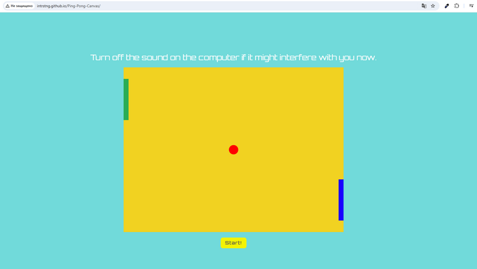

# A game of Ping-Pong created using the Canvas HTML5 API

**Ping-Pong Game (Canvas HTML5 API)** is a browser-based, two-player game built using JavaScript.
Players control paddles via their keyboards, hitting the ball back and forth until a winning score is reached.
The game features physics, collision detection, score tracking, a start timer, sound effects, and an automatic game restart mechanism.

[Deploy](https://intrstng.github.io/Ping-Pong-Canvas/)

*The third part consisted of three tasks that required creating a game board
and game elements:*
- first using the DOM API
- then SVG API
- and finally, rewriting everything using **Canvas HTML5 API**.

## Technologies:
JavaScript (ES6), HTML5, CSS3, **Canvas HTML5 API**, RequestAnimationFrame.

### **Player 1 controls:**

- Racket UP: **ShiftLeft**
- Racket DOWN: **ControlLeft**

### **Player 2 controls:**

- Racket UP: **ArrowUp**
- Racket DOWN: **ArrowDown**
